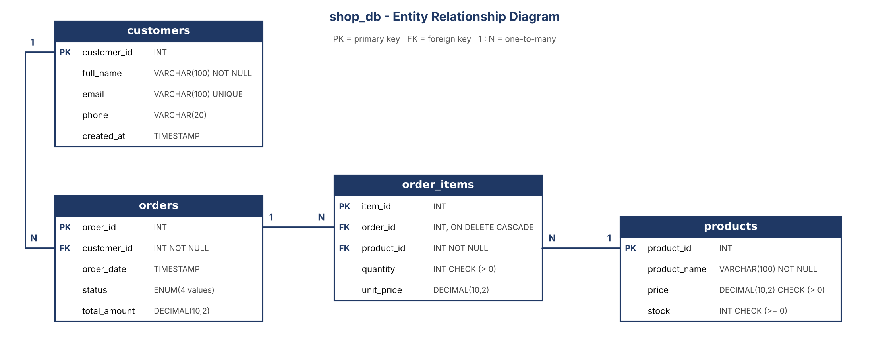

# MySQL Database Testing - Online Store

This is a small database testing project I did to practice QA on the database side. I made a simple online store database in MySQL (customers, products, orders and order items) and wrote test cases to check if the database really protects its data.

I ran everything in MySQL Workbench and wrote the results in a test case sheet.

## The database

   
There are 4 tables. A customer can have many orders, an order can have many items, and a product can be in many order items. If an order is deleted, its items are deleted too.

## How to run it

1. Install MySQL and MySQL Workbench
2. Run the files in the `sql` folder in this order:

   * `01\_schema.sql` creates the database and tables
   * `02\_test\_data.sql` adds sample data
   * `03\_test\_queries.sql` has all the test cases
   * `04\_bug\_fixes.sql` has the fixes for the bugs I found

Run the test queries one at a time (Ctrl + Enter). If you run them all together, Workbench stops at the first error and skips the rest.

## What I tested

I made 25 test cases. The first 18 check that the rules in the database work: unique email, not null, check constraints, foreign keys, cascade delete, default values, and a rollback test. I also wrote a few queries to look for bad data, like orphan order items and totals that don't match.

The last 7 (DB-019 to DB-025) are different. I tried things the database never had a rule for, like a negative item price, a fake email, or letters in a phone number, to see if it would accept them.

## Results

* DB-001 to DB-018: all passed
* DB-019 to DB-025: all 7 failed on the first run, which means 7 issues found
* After I applied the fixes for DB-019 to DB-022 and ran them again, all 4 passed (the database now gives an error)
* DB-023 to DB-025 are still open

The full list is in `docs/test\_cases.xlsx`. The sheet has the original failed results and my notes from the retest.

## Bugs I found

|ID|Test|Problem|Severity|Status|
|-|-|-|-|-|
|BUG-001|DB-019|Negative unit\_price is accepted in order\_items|High|Closed|
|BUG-002|DB-020|Negative total\_amount is accepted in orders|Medium|Closed|
|BUG-003|DB-021|Email without a proper format is accepted|Low|Closed|
|BUG-004|DB-022|Phone number with letters is accepted|Low|Closed|
|BUG-005|DB-023|Order total is not updated when an item is added|High|Open|
|BUG-006|DB-024|Stock is not reduced when an item is ordered|High|Open|
|BUG-007|DB-025|unit\_price can be different from the product price|Medium|Open|

I fixed BUG-001 to BUG-004 with CHECK constraints, then ran the same tests again and the database rejected the bad data, so I closed them.

BUG-005 and BUG-006 need a trigger. I wrote a suggested one in `sql/04\_bug\_fixes.sql` but did not apply it. BUG-007 is left open on purpose, because a different price can be normal (for example a discount), so someone has to decide what the rule should be.

## What I noticed

* The first 18 tests passed because I was only testing rules that already existed. The more useful tests were the ones where I tried to break something the database didn't have a rule for.
* When a test fails and bad data gets saved, I have to delete it before the next test, or it messes up the other results. I added a cleanup query for each of these.
* TODO: add one or two things that surprised you or that you found hard.

## What I want to do next

* Add the trigger for BUG-005 and BUG-006 and retest them
* Try `EXPLAIN` and indexes for a basic performance test
* Automate some of the checks with Python

## Folders

```
sql/          the 4 SQL scripts
docs/         ERD and test case sheet
screenshots/  evidence for the tests
```

